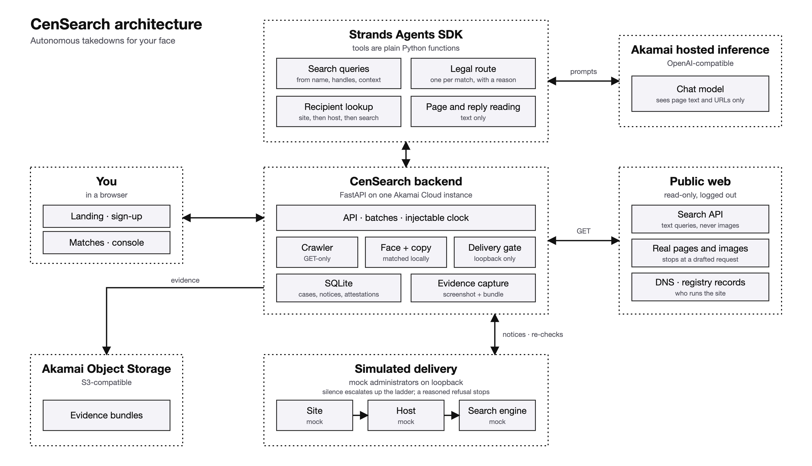

# CenSearch

Find where your face and photos appear, select the matches, and authorize an
agent to work through removal requests. CenSearch chooses a route, finds a
recipient, sends a fixed-template notice when delivery is available, and checks
whether the image is still there. Every decision and notice stays visible.

**[Hosted app](https://172.237.143.49.sslip.io/app/)** ·
**[46-second interface walkthrough](docs/interface-walkthrough.mp4)**

The hosted app requires the team's shared access password. The recording uses
clearly labelled sample data and placeholder images: it demonstrates selection,
authorization, outcome review and settings, with no search or email delivery.
For a password-free local preview, see below.

## The product loop

1. **Enroll.** Add face photos and any originals you own. Settings → Profile
   shows enrollment details and saved photos, with upload and removal controls.
   At least one face photo must remain. Deleting an original also deletes its
   linked matches and request records.
2. **Find.** Search by face, name/handle, or supplied page URLs. FaceCheck requires
   explicit consent to upload the first enrolled face photo and spend three
   credits. Provider scores of 88 or higher appear and can proceed to agent review and
   authorized email delivery without a second local face check. A provider
   score is not proof of misuse or copyright ownership.
3. **Decide.** Select matches and accept responsibility for the batch. Strands
   chooses a copyright notice, impersonation report, intimate-image report,
   voluntary privacy request, leave-alone decision, or hold for review.
4. **Send.** The default is automatic sending after authorization. Optional
   **Review notices before sending** pauses at the exact drafts. Resend sends
   configured email; missing setup leaves drafts. Website forms remain manual.
5. **Verify.** Recheck a page and distinguish removal from a blocked or uncertain
   fetch. A still-present image can become eligible for site → host → search
   engine follow-up. Each follow-up requires new approval; a reasoned refusal
   does not trigger automatic escalation.

Whitelist entries apply to a domain and its subdomains. The current list blocks
new drafts and deliveries, including individual actions. It cannot recall a
request already sent. Stored FaceCheck results can be deleted independently of enrollment
and notice history. Existing scans can be opened from the sidebar or All scans.

## Strands and Akamai

Strands owns the decisions that require reading unfamiliar pages: route choice,
recipient research, page context and reply classification. Its recipient tools
fetch pages with a request budget, inspect policy/contact pages, and query DNS,
RDAP and platform records. Each proposed recipient includes its evidence.
The agent receives page text and URLs, never face photos, and never writes the
legal wording: notices come from fixed templates. Without a model, supported
operations use an explicitly labelled rule fallback.

| Layer | Implementation |
| --- | --- |
| Agent inference | Strands Agents SDK → Akamai's OpenAI-compatible inference, `hackathon-chat` |
| Hosting | One Akamai/Linode instance in Chicago, Docker Compose, Caddy HTTPS |
| API and data | Python 3.12, FastAPI, SQLite and SQLAlchemy |
| Face/copy verification | OpenCV YuNet + SFace on the app host; perceptual hash, SIFT + RANSAC |
| Discovery and capture | FaceCheck; optional SerpApi text search; httpx and Playwright |
| Evidence | Local storage plus optional Akamai Object Storage |
| Frontend | React, TypeScript, Vite; shadcn/ui, Radix, Tailwind and Lucide |
| Email | Resend; separate loopback SMTP/HTTP mock sites for local testing |



## What has been verified

The local checkout and hosted build are different versions. These observations
are dated **2026-10-11 UTC**, not continuous monitoring.

| Check | Evidence and boundary |
| --- | --- |
| Current backend | 270 tests passed in 29.22 seconds using local-only fixtures |
| Current frontend | Product build passed |
| Local end-to-end | Built signup → two matched URLs → reviewed mock send → removal check → approved host follow-up passed in 16.71 seconds; no external calls |
| Profile and whitelist | Real local API browser check passed photo persistence, upload/removal gates, domain/subdomain exclusion, reload, keyboard and 360–1440px layouts |
| Hosted app, fresh health read | SQLite healthy, face models loaded, model configured; public HTTPS returned 401 as expected without the password |
| Hosted Strands inference | Earlier saved deployment validation completed a live DNS tool call; current health retains `live_call_verified: true` |
| Akamai Object Storage | Earlier saved deployment validation recorded synthetic text write/read/delete; current process health reports `remote_verified: false` |

The hosted build still has external delivery and public crawling disabled in
its health response and predates the current email/profile changes. Hosted
owner-face acceptance, production email to a controlled real recipient, and a
real-site removal remain unverified. A saved local CLI FaceCheck run returned
197 candidates; that is not 197 verified matches or a hosted-app acceptance run.
Name/handle search also needs a SerpApi key, absent in the last deployment check.

Local browser/API checks and their scope are recorded in
[verification.json](docs/verification.json). The interface video uses simulated
outcomes; it is not evidence of the model, crawler or delivery provider running.

## Run locally

### Demo (browser only)

Needs Node.js. From the repository root:

```sh
npm install
npm run dev
```

This opens the landing page. The demo runs entirely in the browser: sign-up and
log-in are stored in localStorage, scans return a fixed set of sample matches of
one sample person (photos in `frontend/public/demo`), and batch decisions and
deliveries are simulated. Nothing is uploaded or sent. `npm run build` produces
the same static site in `frontend/dist`, which is what Vercel serves
(`vercel.json`).

### Full app (with the backend)

Install Python 3.12, `uv` and Node.js, then:

```sh
make -C backend setup
cp -n backend/.env.example backend/.env
make -C backend api
```

`setup` installs dependencies, face models, Chromium and the frontend build.
It does not download face datasets. Preserve any existing `.env`. Open
[the local dashboard](http://127.0.0.1:8190/app/); enrollment is at `/signup/`.

For frontend development against the backend, run `npm run dev:backend` in a
second shell. Vite proxies `/api` to port 8190. Builds that should talk to the
backend need `VITE_BACKEND=1 npm run build`.

### Optional providers

Store credentials only in the ignored `backend/.env`, never frontend variables.
The example file lists all settings.

- **Model:** `MODEL_PROVIDER=openai_compatible`,
  `OPENAI_BASE_URL=https://ws.akamai-workshops.com/v1`,
  `CHAT_MODEL=hackathon-chat`, and `OPENAI_API_KEY`.
- **Text search:** `SERPAPI_API_KEY`. Supplied URLs work without it. Each public
  scan requires explicit permission to fetch public pages.
- **Face search:** `FACECHECK_API_TOKEN`. Use the owner's own face while present;
  never upload dataset/fixture people. In `backend/`,
  `uv run python scripts/facecheck.py --info` checks the account without a search.
  The CLI supports explicit upload consent and resuming an existing search ID.
- **Object Storage:** `OBJ_ENDPOINT`, `OBJ_BUCKET`, `OBJ_ACCESS_KEY`,
  `OBJ_SECRET_KEY`. Local storage works without these.
- **Email:** a verified Resend sending domain, `RESEND_API_KEY`,
  `CENSEARCH_EMAIL_FROM` (a bare sender address), and
  `CENSEARCH_EMAIL_ENABLED=true`. Restart, then check `/api/health` →
  `email_delivery.ready`; that flag checks configuration, not live delivery.

Resend receives the fixed notice text, subject and addresses, with no photo or
evidence attachments. The batch contact email becomes Reply-To. Provider
acceptance is recorded with a message ID and means awaiting a response, not
inbox delivery or removal. Uncertain timeouts are not automatically retried;
persistent deduplication and provider idempotency keys guard against duplicates.
Inbox synchronization and bounce webhooks are not implemented.

### Staged pages

Two staged pages show an unauthorized resale and a licensed exhibition of the
same fixture person. Supply authorized local fixtures arranged as
`<person>/originals/*.jpg`, then seed and serve them on loopback:

```sh
cd backend
uv run python -m mockweb.seed_three --photos /absolute/path/to/person --output data/pages
make mock MOCK_ROOT=data/pages
```

Mock sites act as independent administrators over HTTP/SMTP. The backend never
reads their ground truth. Fixtures stay local.

### Checks and deployment

```sh
LIKENESS_TEST_PHOTOS=/absolute/path/to/fixtures make -C backend test
npm run build
npm run lint
backend/.venv/bin/python frontend/tests/profile_browser.py
make -C backend e2e-app PHOTOS=/absolute/path/to/fixtures
```

The profile check uses synthetic face-free images and a disposable real API.
The end-to-end check uses local fixture enrollment, actual crawling, mock
HTTP/SMTP delivery, removal verification and approved host follow-up, with no
intercepted API responses or external calls.

`bash backend/deploy/package.sh /tmp/censearch.tar.gz` creates an allowlisted source
archive. It excludes credentials, local photos/fixtures and runtime data. The
Docker build uses the eye graphic for decorative sample images. A cloud update
is a separate explicit operation via `backend/deploy/deploy.sh`; persistent data
stays in its volume behind Caddy access protection.

## Privacy and limits

Face matching runs on the app host. Only consented FaceCheck discovery uploads
the selected face photo to that provider. Small thumbnails and heavy occlusion
can defeat face matching; copy detection helps only when an original is enrolled.
A different photo of the same person does not support a copyright claim.
Provider candidates and failed fetches require care, not automatic certainty.
The person accepts responsibility for each batch's statements.

This is a hackathon build with shared deployment access, not a multi-tenant
account service. The live owner-face demonstration and real recipient delivery
are acceptance work still to finish. The repo includes the licenses for bundled
fonts and UI components; Cuelume supplies synthesized browser interface sounds.
